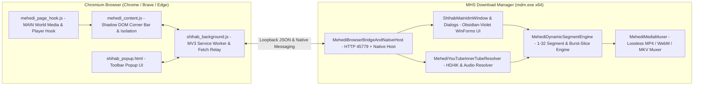

<div align="center">


# MHS Download Manager

**High-Speed Windows x64 Download Accelerator, Smart Browser Video Grabber & Lossless Media Muxer**

Developed by **[Mehedi Hasan Shihab](https://sshihabb007.github.io/)** (`@sshihabb007`)

[](https://github.com/sshihabb007/MHS-MANAGER/releases/latest)
[](https://github.com/sshihabb007/MHS-MANAGER/actions/workflows/build.yml)
[-06B6D4?style=for-the-badge&logo=windows&logoColor=white)](https://github.com/sshihabb007/MHS-MANAGER/releases/latest)
[](#build-from-source)
[](LICENSE)

<br />

[](https://github.com/sshihabb007/MHS-MANAGER/releases/latest/download/MHS-Download-Manager-Setup-1.0.0-x64.exe)

[**Download Installer**](https://github.com/sshihabb007/MHS-MANAGER/releases/latest) · [**Browser Extension Setup**](#extension-setup) · [**Key Features**](#key-features) · [**Architecture**](#architecture) · [**CLI Reference**](#cli-reference) · [**Developer**](#developer)

</div>

---

## Overview

**MHS Download Manager (`mdm.exe` v1.0.0)** is a clean-room, open-source Windows x64 download manager and Manifest V3 Chromium browser extension suite crafted in pure C# and vanilla JavaScript by **Mehedi Hasan Shihab**.

Engineered for maximum throughput and zero bloat, the entire desktop application, custom lossless container muxer, and graphical Windows Setup Wizard compile directly with the inbox Windows `.NET Framework 4.8` compiler (`csc.exe`) — requiring **zero external NuGet packages, zero third-party DLLs, and no external `ffmpeg.exe` installation**.

---

<a id="key-features"></a>
## ✨ Key Features

| Capability | Details |
| :--- | :--- |
| **⚡ Dynamic Segment Acceleration (`1–32` Connections)** | Splits transfers across concurrent HTTP `206 Partial Content` `Range` workers and dynamically subdivides the largest remaining active chunk in flight whenever a worker finishes early. Includes checkpointed **Pause / Resume**, **Refresh Download Address**, **SHA-256** integrity verification, and per-item or global **Speed Limiters**. |
| **🎨 Obsidian-Violet Dark UI (`v1.0.0`)** | Modern pitch-dark interface (`#0F111A` / `#131520`) featuring native Windows 11 DWM dark titlebars, dark Win32 `uxtheme` scrollbars, an instant live search bar, rounded purple-accent cards, `40px` borderless rows, and cyan-to-violet (`#06B6D4` -> `#7C5CFF`) inline progress bars. |
| **🎬 Smart Selected-Video Isolation & Floating Corner Bar (`↻`)** | Sleek icon-only Shadow DOM corner widget (`[MHS Icon] [1080p · N] \| [↻] [▾] [×]`) with one-click **Reloader (`↻`)**. Combines React Fiber / player state inspection, ISO-BMFF `ftyp`/`moof` FNV-1a MSE chunk fingerprinting, and aspect-ratio/duration guards to show **strictly the video you selected** on Facebook, Instagram, YouTube, X/Twitter, TikTok, Reddit, and HTML5 players with exact titles, `VIDEO`/`AUDIO` badges, resolutions, and file sizes. |
| **🚀 High-Speed YouTube HD/4K & Unthrottled Audio** | Built-in InnerTube stream resolver (`144p` up to `1080p`, `1440p`, and `2160p 4K` + original `M4A`/`Opus` audio) paired with parallel burst-sliced HTTP `206` range workers (`1 MiB` audio / `4 MiB` video slices over warm `KeepAlive` TLS sockets) so both multi-GB videos and long companion audio tracks finish in seconds with live transfer rate and ETA. |
| **🎞️ Zero-Dependency Lossless Media Muxer** | Pure C# ISO-BMFF & Matroska muxer (`MehediMediaMuxer`) losslessly combines separate adaptive DASH video + audio tracks (`MP4/fMP4 + M4A -> Fast-Start .mp4`, `MP4 + WebM Opus -> .mp4`, `WebM + WebM -> .webm`, `WebM + M4A -> .mkv`) without re-encoding. *(DRM/EME-protected streams are strictly respected and never bypassed.)* |
| **🌐 Automatic Browser Download Interception** | Intercepts direct, redirected, and extensionless/tokenized downloads (`.mkv`, `.mp4`, `.zip`, `.rar`, `R0*`, `R1*`, `.exe`, `.iso`, `.pdf`, etc.) via `chrome.downloads` + `Content-Disposition` filename resolution, with configurable `Prevent` (`Alt`) / `Force` (`Ins`) keys and automatic **Browser Fetch Relay** recovery when session-bound CDNs return `HTTP 403`. |
| **🧰 Full Desktop Workflow & Setup Wizard** | Includes **Named Queues**, **Scheduler**, **Site Grabber** web crawler, **Batch Download** generator, `.ef2` / `.txt` **Import & Export**, **9-Tab Options** dialog, **System Tray** integration, and a native **Windows x64 Setup Installer** (`MHS-Download-Manager-Setup-1.0.0-x64.exe`) with clean uninstallation and bundled `extension\` folder. |

---

## 📦 Installation & Browser Extension Setup

### 1. Install MHS Download Manager (Windows 10 / 11 x64)

1. Download **[`MHS-Download-Manager-Setup-1.0.0-x64.exe`](https://github.com/sshihabb007/MHS-MANAGER/releases/latest/download/MHS-Download-Manager-Setup-1.0.0-x64.exe)** from [**GitHub Releases**](https://github.com/sshihabb007/MHS-MANAGER/releases/latest).
2. Run the Setup Wizard and choose your preferred installation folder (default: `%LOCALAPPDATA%\Programs\MHS Download Manager`).
3. Setup installs the desktop app, shortcuts, Native Messaging registration, *Installed Apps* uninstaller, and the ready-to-load **`extension\`** folder right inside your installation directory:

```text
<InstallDir>\
├── mdm.exe          # MHS Download Manager 1.0.0 (x64 Desktop Application)
├── extension\       # Unpacked Browser Extension for Chrome, Brave, Edge & Opera
├── Uninstall.exe    # Official Windows Uninstaller
├── README.md        # Documentation
└── LICENSE          # MIT License
```

<a id="extension-setup"></a>
### 2. Load the Browser Extension (Chrome / Brave / Edge)

At the final screen of the Setup Wizard, you can copy or open the installed `extension` folder with one click (or anytime inside the app via **`Help -> Open Browser Extension Folder (Chrome / Brave)...`**):

1. Open your browser's extensions page:
   - **Google Chrome**: `chrome://extensions`
   - **Brave Browser**: `brave://extensions`
   - **Microsoft Edge**: `edge://extensions`
2. Enable **Developer mode** (toggle in the top-right corner).
3. Click **Load unpacked**.
4. Select the **`extension`** folder inside your MHS Download Manager installation directory:
   ```text
   %LOCALAPPDATA%\Programs\MHS Download Manager\extension
   ```

---

<a id="architecture"></a>
## 🏗️ System Architecture



### Repository Layout

```text
MHS-MANAGER/
├── .github/workflows/
│   └── build.yml                           # Automated CI build & GitHub Release publisher
├── assets/
│   ├── mdm.ico                             # Multi-resolution application & installer icon
│   └── mdm.png                             # High-resolution brand logo
├── extension/                              # Manifest V3 Browser Extension (bundled into Setup)
│   ├── manifest.json                       # MV3 manifest (v1.0.0)
│   ├── mehedi_page_hook.js                 # MSE/XHR/fetch & player stream hook
│   ├── mehedi_content.js                   # Floating video bar & single-video isolation
│   ├── shihab_background.js                # Download interception & Browser Fetch Relay
│   ├── shihab_popup.html / mehedi_popup.js # Extension toolbar popup
│   └── images/                             # Extension icons (16px – 128px)
├── src/
│   ├── MehediProgramEntry.cs               # Entry point, CLI router & Native Host switch
│   ├── ShihabMainIdmWindow.cs              # Main Obsidian-Violet window, search, menus & tray
│   ├── MehediDialogsAndProgress.cs         # Add URL, File Info, Live Segment Progress & About
│   ├── ShihabToolsWindows.cs               # 9-Tab Options, Scheduler, Queues & Site Grabber
│   ├── MehediDynamicSegmentEngine.cs       # Multi-segment engine, burst slicer & YT resolver
│   ├── MehediMediaMuxer.cs                 # Zero-dependency ISO-BMFF & Matroska muxer
│   ├── MehediBrowserBridgeAndNativeHost.cs # Loopback HTTP server & Native Messaging host
│   ├── ShihabDownloadModels.cs             # Persistence models, categories & configuration
│   └── installer/
│       └── ShihabSetupWizard.cs            # Windows x64 Setup Wizard & Uninstaller
├── build.ps1                               # Zero-dependency PowerShell build script
├── LICENSE                                 # MIT License
└── README.md                               # Project documentation
```

---

<a id="build-from-source"></a>
## 🛠️ Building from Source

No Visual Studio workload, NuGet restore, or external SDK is required — any standard **Windows 10 / 11** machine includes `.NET Framework 4.8` (`csc.exe`):

```powershell
# Clone the repository
git clone https://github.com/sshihabb007/MHS-MANAGER.git
cd MHS-MANAGER

# Compile both bin\mdm.exe and bin\MHS-Download-Manager-Setup-1.0.0-x64.exe
powershell -NoProfile -ExecutionPolicy Bypass -File .\build.ps1
```

Build outputs generated in `bin\`:
- `bin\mdm.exe` — Main x64 desktop application
- `bin\MHS-Download-Manager-Setup-1.0.0-x64.exe` — Standalone Windows x64 Setup Installer (embeds `mdm.exe`, `extension\`, `README.md`, and `LICENSE`)

---

<a id="cli-reference"></a>
## ⌨️ Command-Line Reference

### Application CLI (`mdm.exe`)

```text
mdm.exe /d <URL> [/p <LocalPath>] [/f <LocalFileName>] [/n] [/q] [/a] [/s]
```

| Flag | Description |
| :--- | :--- |
| `/d <URL>` | Add and download the specified URL |
| `/p <LocalPath>` | Destination directory where the file will be saved |
| `/f <LocalFileName>` | Exact output filename |
| `/n` | Silent mode — start downloading immediately without confirmation dialogs |
| `/q` | Close `mdm.exe` automatically once the download finishes |
| `/a` | Add the file to the download queue without starting immediately |
| `/s` | Start the active download queue immediately |

### Setup Installer CLI (`MHS-Download-Manager-Setup-1.0.0-x64.exe`)

```text
MHS-Download-Manager-Setup-1.0.0-x64.exe [--shihab-silent] [--shihab-install-dir <Path>] [--shihab-no-registry]
```

| Flag | Description |
| :--- | :--- |
| `--shihab-silent` / `/S` | Perform an unattended silent installation (or silent uninstallation with `Uninstall.exe`) |
| `--shihab-install-dir <Path>` | Install into a custom target directory |
| `--shihab-no-registry` | Extract files without writing `HKCU` shortcuts, Startup, or Uninstall registry keys |
| `--shihab-uninstall` | Run uninstallation routine (invoked automatically by `<InstallDir>\Uninstall.exe`) |

---

<a id="developer"></a>
## 👨‍💻 About the Developer

**MHS Download Manager** is designed, engineered, and maintained by **Mehedi Hasan Shihab** — a **Web & Software Developer** focused on building fast, clean, user-centric desktop tools and full-stack web applications.

| Field | Details |
| :--- | :--- |
| **Developer** | **Mehedi Hasan Shihab** *(Web & Software Developer)* |
| **GitHub** | [@sshihabb007](https://github.com/sshihabb007) |
| **Portfolio** | [https://sshihabb007.github.io/](https://sshihabb007.github.io/) |
| **LinkedIn** | [linkedin.com/in/mehedi-hasan-shihab](https://www.linkedin.com/in/mehedi-hasan-shihab) |
| **Email** | [sshihabb007@gmail.com](mailto:sshihabb007@gmail.com) |
| **Project Repository** | [github.com/sshihabb007/MHS-MANAGER](https://github.com/sshihabb007/MHS-MANAGER) |

<div align="center">

[](https://sshihabb007.github.io/)
[](https://github.com/sshihabb007)
[](https://www.linkedin.com/in/mehedi-hasan-shihab)
[](mailto:sshihabb007@gmail.com)

</div>

---

## 📄 License & Responsible Use

Released under the **[MIT License](LICENSE)** — Copyright © 2026 **Mehedi Hasan Shihab (`sshihabb007`)**.

> **Note:** MHS Download Manager accelerates standard HTTP/HTTPS file transfers and non-DRM media streams that your browser already has permission to access. Encrypted DRM / EME streams (`Widevine`, `PlayReady`, `FairPlay`, `SAMPLE-AES`) are strictly respected and never bypassed.
